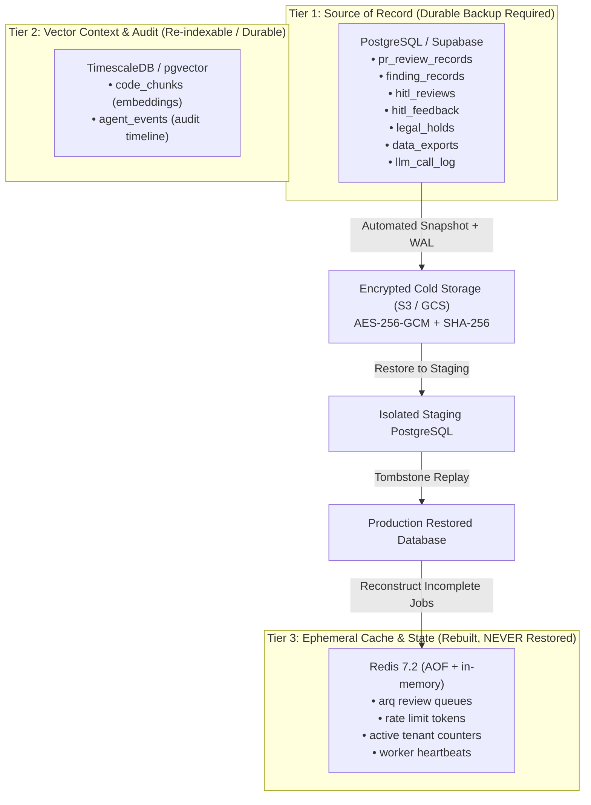

# Hadron Autonomous AI PR Review Agent — Disaster Recovery & Backup Plan

**Status:** ACTIVE  
**Last Verified:** 2026-10-30  
**Version:** 1.0  
**Target Architecture:** Multi-tenant Autonomous AI Code Review Engine  

---

## 1. Objectives & Service Level Indicators (SLIs)

| Metric | Target | Description | Verification Method |
| :--- | :--- | :--- | :--- |
| **RPO (Recovery Point Objective)** | **≤ 15 minutes** | Maximum allowable data gap in the event of catastrophic storage loss. | Continuous PostgreSQL WAL archiving / 15-minute point-in-time snapshots. |
| **RTO (Recovery Time Objective)** | **≤ 60 minutes** | Maximum allowable duration to restore full review capability in an isolated environment. | Automated DR drills restoring database, running integrity checks, and reconciling queues. |
| **Data Integrity Verification** | **100% SHA-256 Match** | Every backup artifact is cryptographically signed and checksummed before storage. | Pre-restore integrity validation checking tamper-evident digests. |
| **Preservation of Erasure** | **Zero Regressions** | Deletion obligations (GDPR Art. 17 / CCPA) must be preserved across any backup restore. | Post-restore tombstone replay re-purging any tenant deleted after snapshot creation. |

---

## 2. Persistence Architecture & Tier Classification

Hadron adopts a strict **Polyglot Persistence** model. Recovery procedures vary depending on the durability tier of each storage engine:



### Storage Engines & Recovery Strategies

1. **PostgreSQL (Source of Record)**:
   - Primary operational store. Holds PR review metadata, security/quality findings, human-in-the-loop decisions, audit logs, and legal holds.
   - **Strategy**: Automated cryptographic snapshots with SHA-256 checksums, encrypted with AES-256-GCM before transport to off-site object storage.
2. **TimescaleDB / Vector Engine (Context & History)**:
   - Stores AST code chunk embeddings and time-series telemetry.
   - **Strategy**: Code chunk embeddings can be reconstructed from repository indexers on demand. Historical agent event timelines are backed up alongside Postgres snapshots.
3. **Redis (Ephemeral Queue & Cache)**:
   - Manages asynchronous job dispatching (ARQ), distributed rate limiting, and ephemeral telemetry.
   - **Strategy**: **NEVER restored from old disk dumps**. Restoring stale Redis dumps causes severe operational hazards: re-queuing already-posted PR reviews, duplicate GitHub comments, and desynchronized rate-limit counters. Redis state is **reconstructed from PostgreSQL durable receipts**.

---

## 3. Disaster Scenarios & Recovery Procedures

### Scenario A: Total Redis Loss / Cache Eviction
*Failure Mode*: Redis container crash, memory eviction, or corrupt AOF/RDB volume.

**Recovery Procedure**:
1. Provision clean Redis instance (empty dataset).
2. Start API and Worker containers with clean connection pools.
3. Execute the Redis Recovery Reconciler (`backend.disaster_recovery.reconciliation.reconcile_after_redis_loss`):
   - Queries PostgreSQL for all reviews in `pending` or `in_progress` status.
   - For each review:
     - Verifies whether a `github_review_id` is already populated. If populated, sets status to `completed` (no replay needed).
     - If unfulfilled, re-enqueues the review job with its unique workflow ID as the idempotency key.
   - Resets active tenant counters and worker heartbeats cleanly.
4. **Acceptance Invariant**: No duplicate reviews or duplicate GitHub comments are ever emitted.

---

### Scenario B: PostgreSQL Catastrophic Loss / Corruption
*Failure Mode*: Database disk failure, unrecoverable table drop, or cloud provider region outage.

**Recovery Procedure**:
1. Provision isolated target PostgreSQL instance or schema (`target_db`).
2. Fetch the latest verified encrypted backup archive from secure cold storage.
3. Validate backup integrity:
   - Verify SHA-256 checksum against manifest.
   - Decrypt archive using the disaster recovery encryption key (`DR_BACKUP_ENCRYPTION_KEY`).
4. Execute `backend.disaster_recovery.restore.restore_backup`:
   - Inspect and verify schema version matches target codebase.
   - Restore database tables in dependency order (`pr_review_records` -> `finding_records`, `hitl_reviews` -> `hitl_feedback`, `legal_holds`, `data_exports`, `llm_call_log`).
   - Validate foreign key constraints and record counts.
5. **Preserve Deletion Obligations (Tombstone Replay)**:
   - A backup taken at $T_0$ may contain data for a tenant who subsequently exercised their Right to Erasure (GDPR Art. 17) at $T_1$, prior to disaster at $T_2$.
   - The restore engine reads the append-only **Tombstone Ledger** (`docs/tombstones/` or audit log) and re-purges any tenant erased after the snapshot date.
   - Zero deleted customer data is ever resurrected.
6. Verify tenant isolation in restored database:
   - Run multi-tenant partition verification (`verify_tenant_isolation`).
7. Switch connection strings to point application traffic to the newly restored database.

---

## 4. Encrypted Backup Specification

Backup archives are structured as self-describing, tamper-evident packages:

```json
{
  "manifest": {
    "backup_id": "dr-snap-20261030-120000-a1b2c3d4",
    "created_at": "2026-10-30T12:00:00Z",
    "schema_version": "v1.0",
    "encryption_algorithm": "AES-256-GCM",
    "sha256_checksum": "e3b0c44298fc1c149afbf4c8996fb92427ae41e4649b934ca495991b7852b855",
    "tenants_included": ["acme-corp", "globex-dev"],
    "record_counts": {
      "pr_review_records": 1420,
      "finding_records": 4812,
      "hitl_reviews": 85,
      "hitl_feedback": 64,
      "legal_holds": 1,
      "data_exports": 3,
      "llm_call_log": 9820
    }
  },
  "payload": "<AES-GCM encrypted binary / base64 payload>"
}
```

---

## 5. Automated Verification Drill Runbook

Disaster recovery readiness is not an assumption; it is proven via recurring automated drills.

### Running a DR Drill
```bash
# 1. Generate an encrypted backup snapshot
python scripts/dr_drill.py --action backup --out /tmp/dr_snapshot.json

# 2. Simulate complete loss and restore to an isolated in-memory or staging database
python scripts/dr_drill.py --action restore-drill --snapshot /tmp/dr_snapshot.json

# 3. Simulate Redis failure and test queue reconciliation
python scripts/dr_drill.py --action test-redis-reconcile
```

---

## 6. Monitored DR Metrics & Alerts

- **Backup Freshness Alert**: Triggered if no verified snapshot has been produced within the last 15 minutes (`RPO_VIOLATION_CRITICAL`).
- **Integrity Validation Alert**: Triggered if a backup checksum fails decryption or SHA-256 verification (`BACKUP_INTEGRITY_FAIL`).
- **Restore Time Alert**: Triggered if automated restore drill takes > 45 minutes (`RTO_HEADROOM_WARNING`).
- **Tombstone Sync Alert**: Triggered if a restored database fails to prune tenants listed in the erasure tombstone ledger (`ERASURE_OBLIGATION_BREACH`).
